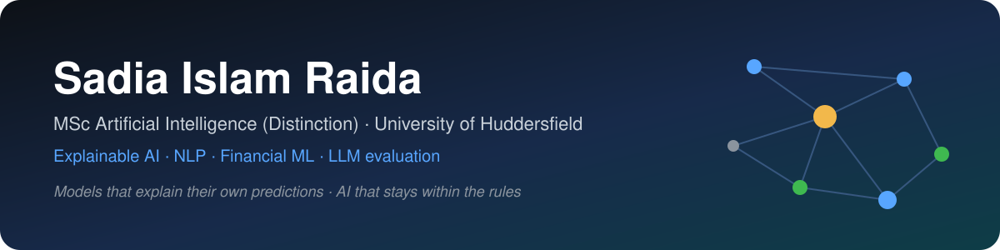

  

  
  
  

## 👋 About me

I build machine-learning models that **explain their own predictions**, and I test whether AI systems **stay within the rules**. My MSc dissertation compared news sentiment with inter-stock graph structure for equity forecasting. My current project measures when AI chatbots cross from financial guidance into regulated advice.

- 🎓 **MSc Artificial Intelligence (Distinction)**, University of Huddersfield (2025–2026)
- 🎓 **BSc Computer Science**, North South University (2020–2024)
- 🔍 Interests: explainable AI, NLP, graph learning, financial ML, LLM evaluation and AI safety
- 💼 Open to **Junior ML Engineer, AI Engineer and Data Scientist** roles in the UK

## 🚀 Featured projects

<table>
<tr>
<td width="50%" valign="top">

### ⚖️ [AdviceLine](https://github.com/Raida27/AdviceLine)
**When do AI chatbots cross from financial guidance into advice?**

An open UK benchmark of 300 prompts built on the FCA's 2026 targeted support rules, three open LLMs run on a GPU, an LLM judge checked against human labels, classifiers, and a guardrail API tested by a blinded A/B experiment.

`LLMs` `AI safety` `fintech` `DuckDB` `SQL` `FastAPI` `Streamlit`

🛠️ In progress · 2026

</td>
<td width="50%" valign="top">

### 📈 Multi-Horizon Equity Forecasting
**MSc dissertation: news sentiment vs inter-stock graph structure**

FinBERT sentiment + LSTM against a Graph Attention Network, evaluated across forecast horizons with Diebold–Mariano tests, validated on unseen tickers, and explained with SHAP, Integrated Gradients and attention analysis.

`PyTorch` `FinBERT` `GAT` `SHAP`

📄 Code coming soon

</td>
</tr>
<tr>
<td colspan="2">

### 🏢 Firm Performance Prediction with Ensemble Learning
Benchmarked eight classifiers, from logistic regression to XGBoost, with grid-search tuning to predict firm performance from business practices. `scikit-learn` `XGBoost`

</td>
</tr>
</table>

## 🧰 Tech stack

| | |
|---|---|
| **Languages** |   |
| **Machine learning** |     |
| **Data & evaluation** |     |
| **Explainable AI** |    |
| **Engineering** |      |
| **Learning now** |    |

## 📫 Get in touch

The best way to reach me is on [LinkedIn](https://www.linkedin.com/in/sadia-islam-raida-98b22319b).
